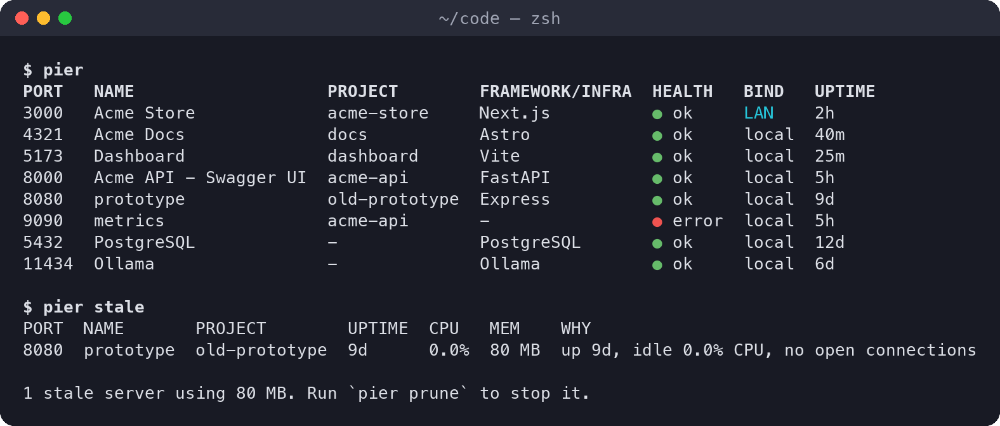
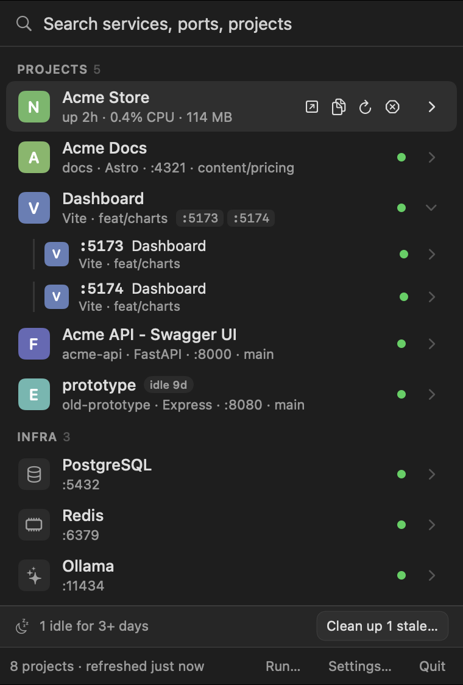
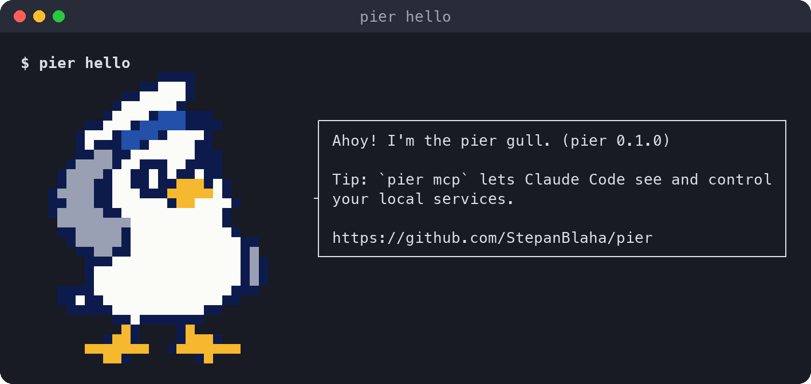

<p align="center">
  
</p>

<h1 align="center">pier</h1>

<p align="center">
  <b>See what's running on localhost, and which project it belongs to.</b><br>
  A macOS menu bar app and CLI for finding, opening, restarting and cleaning up your dev servers.
</p>

<p align="center">
  <a href="https://github.com/StepanBlaha/pier/actions/workflows/ci.yml"></a>
  <a href="https://github.com/StepanBlaha/pier/releases/latest"></a>
  
  
  <a href="LICENSE"></a>
</p>

---


> *"Port 3000 is already in use. By what?!"*

Every web developer ends up with a pile of forgotten dev servers. `lsof` says `node 4821 *:3000`, which
tells you nothing when six `node` processes are running.

**pier** is a little gull who keeps watch over your ports. For each one, it tells you **which project**
it belongs to (from the process's working directory), the **framework** (Next.js, Vite, Astro, Rails,
Django, FastAPI and more), the **page title and favicon**, the **git branch**, whether it's **healthy**,
whether it's **reachable from your LAN**, and **what started it** (VS Code, iTerm, tmux, Claude Code).
Then it lets you open, restart, stop, share or clean up any of it.

<p align="center">
  
</p>

## Install


```bash
brew install stepanblaha/tap/pier
pier app install        # optional: the menu bar app
```

The formula builds pier from source with your Swift toolchain (Xcode or the Command Line Tools), so
macOS never shows a Gatekeeper warning. Requires macOS 14 or later.

<details>
<summary>Other ways to install</summary>

**Prebuilt app:** grab `pier-<version>-macos-arm64.zip` from [Releases](https://github.com/StepanBlaha/pier/releases),
move `Pier.app` to `~/Applications`, then clear the download quarantine (pier isn't notarized):

```bash
xattr -dr com.apple.quarantine ~/Applications/Pier.app
```

The CLI ships inside the app at `Pier.app/Contents/Resources/pier`.

**From source:**

```bash
git clone https://github.com/StepanBlaha/pier && cd pier
swift build -c release
ln -sf "$PWD/.build/release/pier" /usr/local/bin/pier   # or any directory on your PATH
```
</details>

## The menu bar app



Press <kbd>⌥</kbd><kbd>⌘</kbd><kbd>P</kbd> anywhere, type a few letters and hit <kbd>⏎</kbd>.

- **One row per project.** Five ports of the same app collapse into a single row with port chips.
- **Hover a row** to open, copy the URL, read logs, restart or stop it, and see uptime, CPU and memory.
- **Details panel** with URLs (local, LAN, tunnel), git branch, runtime, owners, a QR code for your phone,
  *open in editor* and *jump to the terminal that started it*.
- **Stale servers** get an *idle 9d* badge and a one-click clean-up.
- **Stacks** from `pier.yml` start and stop with one button, and **Run…** starts any project's dev
  server under pier, logs included.
- **Pin and rename** what matters. Get a notification when a managed server crashes.

The gull lives in your menu bar and adapts to light and dark mode.

<br clear="right">

## The terminal tool


Most commands take a **target**: a port (`3000`, always exact) or a fuzzy name (`shop`, `next`,
`postgres`). Every command supports `--json`.

### Look around

| Command | What it does |
|---|---|
| `pier` | Lists everything listening, labeled by project. `--all` includes system noise |
| `pier watch` | Live `top`-like view. Keys: <kbd>o</kbd> open, <kbd>c</kbd> copy, <kbd>k</kbd> kill, <kbd>/</kbd> filter, <kbd>⏎</kbd> details |
| `pier info <target>` | Everything pier knows: path, branch, runtime, owners, CPU and memory, command line |
| `pier url <target>` | Prints the URL, pipe-friendly. `--lan` gives the LAN URL, `--tunnel` the public one |
| `pier stale` | Finds forgotten dev servers: long uptime, idle, no open connections |

### Do things

| Command | What it does |
|---|---|
| `pier open <target>` | Opens it in your browser, switching to the existing tab if there is one. `--editor` opens the project, `--terminal` jumps to the terminal that started it |
| `pier stop <target>` | Stops it cleanly. Databases, Docker and system services ask first |
| `pier prune` | Stops every stale server after one confirmation. `--dry-run` just shows them |
| `pier qr <target>` | Prints a QR code of the LAN URL, for testing on your phone |
| `pier free [port]` | Prints the next free port |
| `pier pin` / `pier rename` | Keeps a service at the top, or gives it a nicer name (shared with the app) |

### Managed mode: logs and real restarts

When pier starts a server itself, it can keep its logs and restart it exactly.

| Command | What it does |
|---|---|
| `pier run` | Runs your `package.json` `dev` script under pier. `pier run -- python app.py` works for anything |
| `pier logs <target> -f` | Follows the logs |
| `pier restart <target>` | Restarts it. A server pier didn't start gets adopted, so its logs are captured from then on |
| `pier up` / `pier down` | Starts or stops a whole stack from [`pier.yml`](docs/pier-yml.md), in dependency order |

### Share and integrate

| Command | What it does |
|---|---|
| `pier expose <target>` | A public HTTPS URL through a Cloudflare quick tunnel (needs `cloudflared`) |
| `pier mcp` | An MCP server, so Claude Code and other agents can see your services, read logs and restart them |
| `pier completions --install` | Tab completion for live ports and names (zsh, bash, fish; Homebrew installs it for you) |
| `pier config` | Reads and changes settings shared with the app: editor, hotkey, notifications |
| `pier hello` | Says hi |

<p align="center">
  
</p>

## Do I need the app running?

No. The CLI scans your ports itself every time you run it, and servers started with `pier run` live
in their own small wrapper processes. There's no background daemon.

The menu bar app adds the always-there list, the <kbd>⌥</kbd><kbd>⌘</kbd><kbd>P</kbd> hotkey and crash
notifications for managed servers (those only arrive while the app is running). Turn on **Launch at
login** in Pier → Settings if you want it around all the time.

## Use with Claude Code


```bash
claude mcp add pier -- pier mcp
```

Then ask things like *"what's running on my machine?"*, *"start the docs site and wait until it's
healthy"* or *"show me the last 50 log lines of shop"*. The MCP server can list services, read logs,
start, restart and stop servers, find free ports and wait for a port to come up. Stopping databases or
system services always needs explicit confirmation.

## Works in any terminal


Terminal.app, iTerm2, Ghostty, kitty, WezTerm, Warp, Alacritty, the VS Code and JetBrains terminals,
tmux, screen and ssh. pier respects `NO_COLOR`, `FORCE_COLOR` and `TERM=dumb`, uses only the 16
basic colors so it reads well on light and dark themes, falls back to ASCII when the locale isn't
UTF-8, and strips escape sequences from page titles before printing them. Even the gull degrades:
truecolor pixel art, then 256 and 16 colors, then hand-drawn ASCII.

## How it works

- **Discovery** uses native `libproc` calls (no shelling out to `lsof`) and scans every port in about 0.1s.
- **Identification** combines the process's working directory, its arguments, `package.json`,
  `.git/HEAD`, well-known infrastructure ports, the Docker Engine API and a quick HTTP probe for the
  page title and favicon.
- **Managed mode** runs your command in a pseudo-terminal, so colors still work. Output goes to a ring
  buffer served over a unix socket.

pier needs process information and signals, so it can't be sandboxed and isn't on the Mac App Store.

## Contributing


Bug reports, ideas and pull requests are welcome. See [CONTRIBUTING.md](CONTRIBUTING.md) for how to
build and test, and [docs/IDEAS.md](docs/IDEAS.md) for what might come next. Please report security
issues privately, as described in [SECURITY.md](SECURITY.md).

## License

[MIT](LICENSE) © Štěpán Bláha
